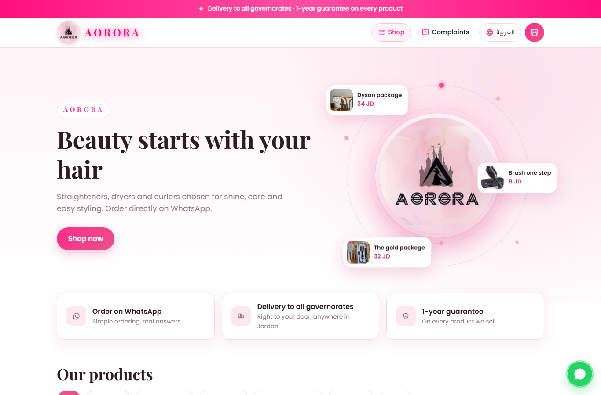
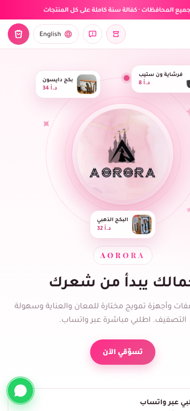
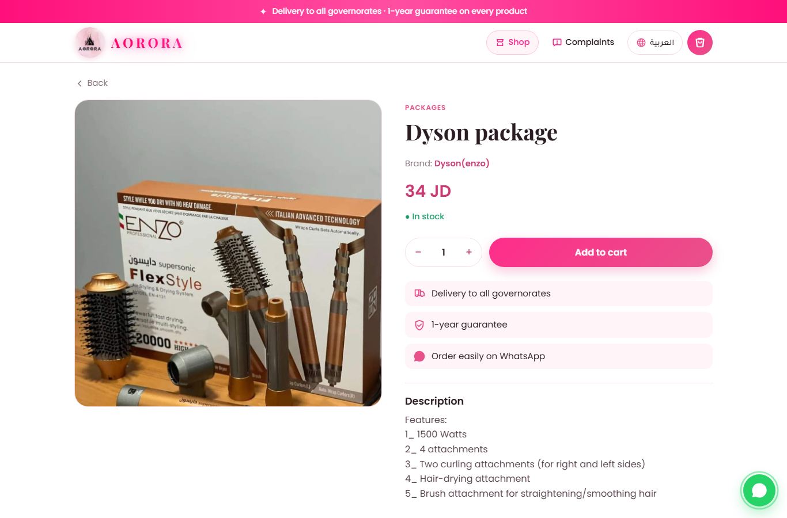
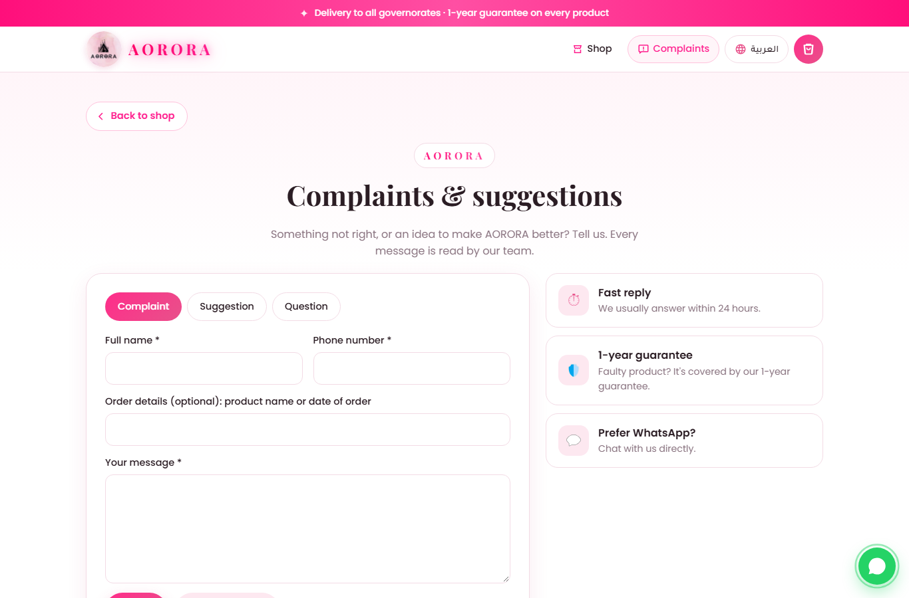
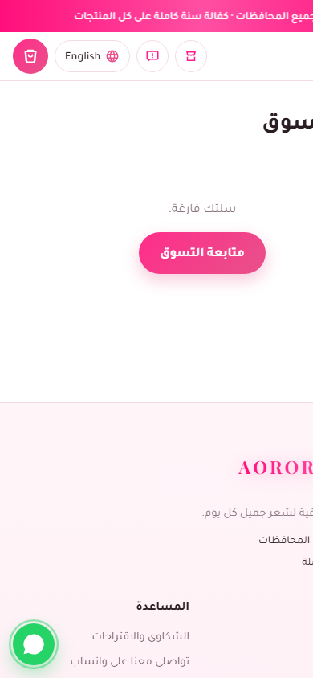

<p align="center">
  
</p>

<h1 align="center">AORORA · Online Hair-Tools Store</h1>

<p align="center">
  A bilingual (Arabic / English) e-commerce site for a women's hair-tools brand in Jordan.<br>
  Customers browse, fill a cart and send the order straight to the shop on <b>WhatsApp</b>.<br>
  The owner manages everything from a password-protected admin panel, no coding needed.
</p>

<p align="center">
  
  
  
  
  
</p>

---

## Screenshots

| Home (desktop) | Arabic · mobile |
|---|---|
|  |  |

| Product page | Complaints & suggestions | Cart · Arabic |
|---|---|---|
|  |  |  |

## Features

**For customers**
- Arabic ⇄ English switch with full right-to-left layout for Arabic
- Mobile-first pink & white design, animated hero with the brand logo and live product cards
- Categories (straighteners, dryers, wavers & curlers, packages) and brand filters
- Offers: sale price, crossed-out old price, `-X%` badges and a "Today's best deals" section
- Cart in the browser and **one-tap ordering on WhatsApp**: the message contains every item, quantity, total and a link to each product page
- Prices in Jordanian dinar (up to 3 decimals), delivery to all governorates, 1-year guarantee
- Complaints & suggestions page with a reference number, spam protection (honeypot + rate limit)
- Floating WhatsApp button, editable announcement bar, Open Graph previews for sharing

**For the shop owner (admin panel)**
- Add / edit / delete products: photo, names and descriptions in both languages, price, old price, brand, category, stock
- Bulk import from an Excel (`.xlsx`) or CSV template together with many photos at once
- Inbox for complaints with "reply on WhatsApp", mark resolved, delete
- Settings: WhatsApp number, Instagram link, logo, headline text, announcement bar
- Photos are resized and re-encoded automatically

**Security**
- Admin password from environment variables, constant-time comparison, login rate limiting
- CSRF tokens on every form, HTTP-only session cookies
- Uploaded images are re-encoded with Pillow (no raw files served)

## Tech stack

| Layer | Tools |
|---|---|
| Backend | Python 3.12, Flask, Gunicorn |
| Database | SQLite (auto-migrating schema) |
| Frontend | Jinja templates, plain CSS (RTL/LTR), vanilla JavaScript |
| Images & Excel | Pillow, openpyxl |
| Deployment | Docker / Docker Compose on a Linux server |

## Run it yourself

```bash
git clone https://github.com/Abood-ALdeek/aorora-store.git
cd aorora-store
cp .env.example .env      # then set ADMIN_PASSWORD and SECRET_KEY
docker compose up -d --build
```

Open `http://localhost:8090` for the store and `http://localhost:8090/admin` for the admin panel.

Without Docker:

```bash
pip install -r requirements.txt
DATA_DIR=./data ADMIN_PASSWORD=change-me flask --app app run
```

## Project structure

```
app.py              Flask app: storefront, cart API, admin, import, complaints
translations.py     All Arabic and English texts
templates/          Pages (Jinja)
static/             style.css, app.js (cart + WhatsApp), images
data/               store.db and uploaded photos (not in git)
docker-compose.yml  Container setup
```

## Author

Built by **Abood Aldeek** for the AORORA brand · Instagram [@aorora__1](https://www.instagram.com/aorora__1)
